# Spectre Studio

A Phoenix LiveView control center for observing, controlling and analysing one
or more Spectre systems from a single interface.

Studio contains no Agent logic and does not touch Agent processes. It uses:

- **[Spectre Pulse](https://github.com/elchemista/spectre_pulse)** for the
  authenticated realtime connection, discovery and runtime monitoring;
- **[Spectre Lab](https://github.com/elchemista/spectre_lab)** for offline
  checkpoint playback and comparison;
- other Spectre extensions through the bridge in [`docs/STUDIO_BRIDGE.md`](docs/STUDIO_BRIDGE.md).



[Diagram source](docs/assets/readme-architecture.mmd).

## Spectre compatibility

Studio currently depends on Spectre `~> 0.3.4` and uses the retained
`Spectre.Instance` monitoring and bridge APIs. Its panels have not been migrated
to the 0.4 `Spectre.Server` diagnostics protocol. Keep a compatible host/Pulse
version for this bridge; changing the core dependency alone does not migrate
the integration. The core [compatibility guide](https://github.com/elchemista/spectre/blob/main/docs/COMPATIBILITY.md)
indexes the retained APIs and their legacy guides.

The [0.4 playground](https://github.com/elchemista/demo_spectre) demonstrates the
AgentServer, shared GAM and PostgreSQL integration. See the
[bridge guide](docs/STUDIO_BRIDGE.md) for the protocol Studio currently supports.

## Running it

```console
mix setup
mix phx.server
```

Then open [localhost:4000](http://localhost:4000). There is no sign-in: Studio
opens straight onto the dashboard.

## Access

Studio has no authentication, so **the address it listens on is the access
control**. It binds to loopback by default in development and in production.

To reach it from another machine, tunnel to it:

```console
ssh -L 4000:127.0.0.1:4000 operator@studio-host
```

Setting `STUDIO_BIND_IP=0.0.0.0` exposes the dashboard, and with it every stored
connection token, to anyone who can reach the port. Do that only behind a proxy
that authenticates.

## Configuration

One secret is required in production, generated by a mix task:

```console
mix studio.secrets
```

| Variable | Meaning |
| --- | --- |
| `STUDIO_VAULT_KEY` | 32-byte base64 key sealing stored connection tokens |
| `STUDIO_VAULT_PATH` | Where the connection store lives |
| `STUDIO_BIND_IP` | Listening address, `127.0.0.1` by default |
| `SECRET_KEY_BASE`, `PHX_HOST`, `PORT` | Standard Phoenix settings |

Without a vault key Studio refuses to store a connection token rather than
writing someone's production credential to disk in the clear.

## Connecting to a host

The host application mounts a Pulse socket:

```elixir
socket "/pulse", MyAppWeb.PulseSocket,
  websocket: [connect_info: [:peer_data, :uri]],
  longpoll: false
```

and starts Pulse with a connection that exposes Agents and grants scopes. Add
the endpoint in Studio under `./connections`; the token is sent as `?token=` on
the socket URL, which is the shape Pulse's own Phoenix guide documents.

## What Studio shows, and what it does not

Realtime monitoring samples Pulse's complete publication-safe `Process.info/2`
allowlist from the OTP process behind one Agent Instance. Studio shows five
summary charts plus the complete current snapshot. It is not the Agent's history:

- no mailbox contents, process dictionary or GenServer state;
- no memory records, prompts or model calls;
- token totals belong to Ledger, not to this stream.

The separate Work/Vigil panel uses Pulse's `agent.operations.*` protocol and
shows publication-safe bounded loop views. It is still an observation stream,
not durable operation history.

Gaps are shown as gaps. A break in a sparkline means samples were never
observed, and a gap in a Lab timeline means Spectre coalesced checkpoint writes
— neither is interpolated, and neither is lost history.

Monitoring is never on by default. It starts when an operator asks for it and
stops when the panel closes, the tab changes, or the LiveView dies.

When a host advertises the application bridge scopes, each Agent also gets:

- a semantic-cache review queue with explicit **verify + promote**;
- a bounded persisted Journal/turn view;
- the current compiled Skill inventory;
- governed Morph Skill proposals that stop after evaluation, before approval
  or activation.

All known tabs remain visible. Locked tabs and the Overview capability matrix
show the exact scopes missing from the remote manifest, so an unavailable
capability is distinguishable from a Studio rendering bug.

The bridge shapes and host responsibilities are in
[`docs/STUDIO_BRIDGE.md`](docs/STUDIO_BRIDGE.md).

## Documentation

- [`docs/UI.md`](docs/UI.md) — the visual language, its tokens and components
- [`docs/STUDIO_BRIDGE.md`](docs/STUDIO_BRIDGE.md) — Pulse operations and grants
  that unlock Cache, Journal, Skills and Morph

## Development

```console
mix precommit   # compile --warnings-as-errors, deps.unlock, format, credo, test
```

The test suite runs against `SpectreStudio.FakePulse`, a stand-in server that
speaks the current Pulse connection protocol, including OTP and Work/Vigil
monitoring plus correlated application-bridge replies. The connection layer,
monitoring lifecycle and failure paths are therefore testable without a running
Spectre system.

Each panel is its own LiveView. Lists that grow — endpoints, event logs, sent
envelopes, bundles, timelines — are LiveView streams, and work that can take a
while, such as verifying a bundle or diffing two chains, runs through
`start_async`/`assign_async` and reports itself as in flight.
